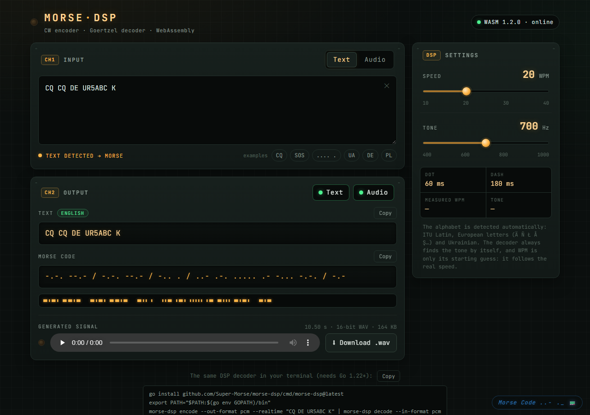
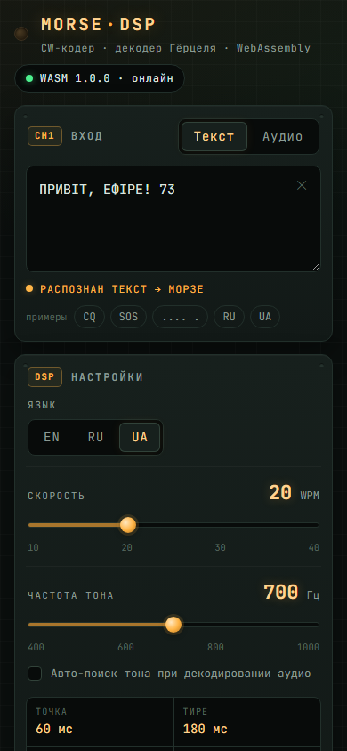
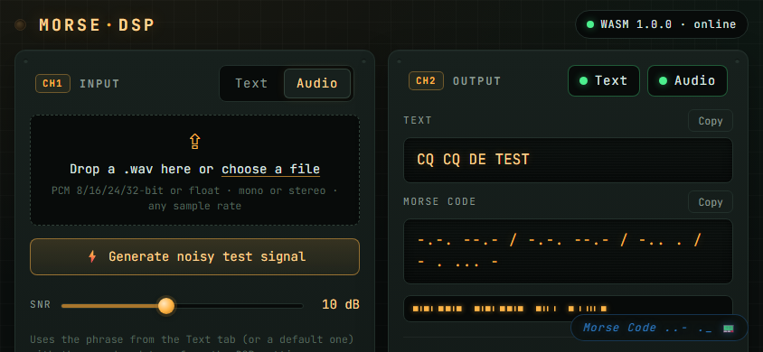

# 📟 Morse DSP — CW Encoder & Streaming Decoder

A high-performance **Morse code (CW)** toolkit written in pure **Go (Golang)**: a text codec, a CW audio synthesizer and a **real-time DSP decoder** built on the **Goertzel algorithm**, shipped as a Unix-pipe-friendly **CLI** and as a **WebAssembly (WASM)** radio console that runs entirely in the browser. **Automatic multi-language detection** covers ITU Latin, the major European alphabets with diacritics (German, French, Spanish, Polish, Nordic, Turkish) and **Ukrainian**, and the decoder finds the tone by itself — no language or tone setting needed.

🚀 **Live Web Console:** [https://super-morse.github.io/morse-dsp](https://super-morse.github.io/morse-dsp)

📘 **Study Guide (Ukrainian):** [morse-dsp зсередини](https://super-morse.github.io/morse-dsp/learn.html) — the architecture, the DSP and the code explained step by step for students.

🔗 **Upcoming Companion:** `sdr-receiver` (Python) — demodulates KiwiSDR / RTL-SDR radio into audio and pipes it straight into `morse-dsp decode`.

<p align="center">
  <!-- CI/CD & SonarCloud Badges -->
  <a href="https://github.com/Super-Morse/morse-dsp/actions/workflows/sonar.yml">
    
  </a>
  <a href="https://sonarcloud.io/summary/new_code?id=Super-Morse_morse-dsp">
    
  </a>
  <a href="https://sonarcloud.io/summary/new_code?id=Super-Morse_morse-dsp">
    
  </a>
  <a href="https://sonarcloud.io/summary/new_code?id=Super-Morse_morse-dsp">
    
  </a>
  <a href="https://sonarcloud.io/summary/new_code?id=Super-Morse_morse-dsp">
    
  </a>
  <br />
  <!-- Tech Stack Badges -->
  
  
  
  
  
</p>

👉 **Live Analytics Dashboard:** [SonarCloud Project Overview](https://sonarcloud.io/project/overview?id=Super-Morse_morse-dsp)

---

## 🧠 Interesting Fact

Morse code is older than the telephone, yet it is still on the air every day:

* On **May 24, 1844** Samuel Morse sent the first long-distance telegraph message, *"What hath God wrought"*, from Washington to Baltimore.
* **SOS** is not an abbreviation: it was chosen in 1906 simply because `... --- ...` is impossible to mistake. Morse remained the maritime distress standard until **1999**.
* Timing is defined by the word **PARIS**: exactly **50 units** long, so at *N* WPM one dot lasts `1200 / N` ms.
* The receiving record, **75.2 WPM**, was set by Ted McElroy in **1939** — about 16 ms per dot. This decoder copies it too (start it with `--wpm 40`; up to 50 WPM the default start is enough).

---

## 📊 Code Quality & SonarCloud Metrics

| Metric | Status / Value | Description |
|---|---|---|
| **🎯 Coverage** | **100% core · 99.9% overall** | `pkg/morse` fully covered; the CLI is tested through `run()`, only the one-line `main()` stays outside. |
| **🧪 Test Suite** | **77 tests, 0 failures** | Unit, language detection, end-to-end (noisy audio → text in 9 languages) and CLI tests; the core suite also runs compiled to WebAssembly. |
| **🧹 Maintainability** | **Cognitive complexity ≤ 15** | Every function stays below Sonar's `go:S3776` threshold; `go vet` and `gofmt` clean. |
| **🔒 Dependencies** | **Go standard library only** | No third-party modules, no cgo, no `os`/`syscall`/`syscall/js` in the core (enforced by a test) — compiles unchanged for `GOOS=js` and is ready for a `c-shared` SDR adapter. |
| **⚡ Performance** | **1,000–1,500× real time** | Decoding 8 kHz audio on one CPU core (`make bench`, varies with the machine); language detection adds no measurable cost. |

Live ratings for security, reliability and duplication are published by SonarCloud on every push to `main` (see the badges above).

---

## 📸 Demo & Interface

<details open>
<summary><b>Click to expand screenshots</b></summary>
<br>

<div align="center">
  <table border="0" cellspacing="10" cellpadding="0">
    <tr>
      <td align="center" valign="top" width="64%">
        <b>🖥️ Desktop Radio Console</b><br><br>
        
      </td>
      <td align="center" valign="top" width="30%">
        <b>📱 Mobile Portrait</b><br><br>
        
      </td>
    </tr>
    <tr>
      <td align="center" valign="top" colspan="2">
        <b>📱 Mobile Landscape (input and output side by side)</b><br><br>
        
      </td>
    </tr>
  </table>
</div>

</details>

---

## ✨ Features

- **Automatic Multi-Language Detection:** a data-driven `LanguageProfile` registry (ITU English, Ukrainian, German, French, Spanish, Polish, Swedish/Nordic, Turkish). Encoding takes any supported letter without a flag; decoding picks the alphabet from the codes themselves — invalid-code penalties, unique-marker codes, letter frequencies and n-gram/word statistics — with ham abbreviations, callsigns and short bursts always reading as ITU.
- **Bidirectional Text Codec:** Text ⇄ Morse with digits and ITU punctuation. Lenient parsing of `.` `·` `•` / `-` `_` `—` notations and `/`, `|` or double-space word separators.
- **Clean CW Synthesis:** Continuous-phase sine keyed with **5 ms raised-cosine ramps** (no key clicks), PARIS timing, configurable WPM and tone, optional **white Gaussian noise at a given SNR** for testing.
- **Streaming DSP Decoder:** Sliding **Goertzel** filter → envelope detector → **adaptive threshold** (median noise floor, peak tracker, squelch, hysteresis) → glitch filter → **automatic WPM tracking** → text, emitted character by character in real time — the language detector never delays the output, and a **sticky session language** keeps short replies (`ТАК`, `JA`) in the right alphabet.
- **Automatic Tone Search:** Always on — a Welch/FFT spectrum scan finds the CW tone between 300 and 1500 Hz; in the CLI, `--freq N` pins a known tone.
- **SDR-Ready Pipe Interface:** Reads raw `s16le`/`f32le` PCM from stdin with low latency — designed for an SDR receiver piping its audio straight into `morse-dsp decode`.
- **WAV I/O:** Reads 8/16/24/32-bit PCM and 32/64-bit float WAV (mono or stereo, any rate, even streamed WAVs); writes 16-bit PCM.
- **In-Browser Radio Console:** The same Go code compiled to WASM. Detects text vs Morse and the language as you type (no language selector), decodes uploaded WAVs, generates noisy test signals in one click, and re-keys a **clean signal** from what the decoder heard.
- **Responsive Mobile UX:** In portrait the output sits right under the input and the DSP settings move to the bottom; in landscape input and output sit side by side. Safe-area insets for notched phones, touch-sized controls, no horizontal scrolling down to 320 px.

---

## 🛠️ Technical Stack & Architecture

- **Core Engine:** Go (Golang), standard library only
- **Compilation Targets:** native CLI, WebAssembly (`GOOS=js GOARCH=wasm`)
- **Frontend:** Vanilla JavaScript (ES2020+), HTML5 Audio, Canvas, CSS Grid
- **Quality & DevOps:** Go test + coverage, SonarCloud CI, GitHub Pages deployment

```text
       ┌────────────────────────┐
       │  Text / Morse / Audio  │ ◄─── CLI args · stdin pipe · WAV · Web UI
       └───────────┬────────────┘
                   │
                   ▼
       ┌────────────────────────┐
       │   pkg/morse (pure Go)  │ ◄─── LanguageProfiles · Detector · Codec · Encoder · WAV/PCM
       └───────────┬────────────┘
                   │
                   ▼ (streaming samples)
       ┌────────────────────────┐
       │   Goertzel DSP Decoder │ ◄─── Adaptive Threshold · WPM Estimator · Language Tracker
       └───────────┬────────────┘
                   │
         ┌─────────┴──────────┐
         ▼                    ▼
┌──────────────────┐  ┌──────────────────┐
│  cmd/morse-dsp   │  │    cmd/wasm      │
│  CLI · stdout    │  │  WASM · Web UI   │
└──────────────────┘  └──────────────────┘
```

### 📡 Ecosystem: Unix Pipe from the SDR Receiver

```text
┌───────────────────────────────┐                    ┌───────────────────────────────┐
│ sdr-receiver (Python)         │   raw PCM, mono    │ morse-dsp decode (Go)         │
│ IQSource → demodulator → audio│ ─────── stdin ───▶ │ Goertzel → threshold → text   │ ──▶ stdout
└───────────────────────────────┘   s16le / f32le    └───────────────────────────────┘
```

The contract is a header-less stream of samples:

| Parameter | Value | Flag |
|---|---|---|
| Sample format | `s16le` (default) or `f32le` | `--sample-format` |
| Channels | 1 (mono) | — |
| Sample rate | any, 1–384 kHz (default 8000; KiwiSDR uses 12000) | `--rate` |

```python
import sys
import numpy as np

def emit(audio: np.ndarray) -> None:
    """audio: mono float samples in [-1, 1] at RATE Hz."""
    pcm = (np.clip(audio, -1, 1) * 32767).astype("<i2")
    sys.stdout.buffer.write(pcm.tobytes())
    sys.stdout.buffer.flush()
```

```bash
# sdr.py is your receiver script (or the upcoming sdr-receiver) writing samples with emit()
python sdr.py | ./bin/morse-dsp decode --in-format pcm --rate 12000 --linebreak 2

# no radio at hand: the encoder plays a live station in real time
./bin/morse-dsp encode --out-format pcm --realtime "CQ DE UR5ABC K" | ./bin/morse-dsp decode --in-format pcm
```

---

## 🚀 Local Development Setup

Requires **Go 1.22+** (Python 3 for `make serve`, Node.js for `make test-wasm`).

### 1. Clone the repository
```bash
git clone https://github.com/Super-Morse/morse-dsp.git
cd morse-dsp
```

### 2. Build the CLI and the WebAssembly binary
```bash
make            # tests + bin/morse-dsp + docs/main.wasm
make cli        # bin/morse-dsp only
make wasm       # docs/main.wasm + the wasm_exec.js matching your Go toolchain
```

### 3. Launch the local web console
```bash
make serve      # serves docs/ on http://localhost:8080
```

The page must be served over HTTP: browsers refuse to load WebAssembly from `file://`.

---

## 💻 CLI Usage

```text
morse-dsp [encode|decode] [flags] [text ...]
morse-dsp --mode encode|decode [flags] [text ...]
```

Install the CLI alone with Go 1.22+ (or build `./bin/morse-dsp` with `make cli`):

```bash
go install github.com/Super-Morse/morse-dsp/cmd/morse-dsp@latest
export PATH="$PATH:$(go env GOPATH)/bin"   # if Go's bin directory is not on PATH yet
```

Input comes from text arguments, `--in`/`-i`, or stdin; output goes to `--out`/`-o` or stdout. Without a mode the tool decides: Morse text and audio are decoded, anything else is encoded.

```bash
# A. Text → Morse (any supported alphabet, no flag needed)
morse-dsp encode "HELLO WORLD"                      # .... . .-.. .-.. --- / .-- --- .-. .-.. -..
morse-dsp encode "ПРИВІТ, ЕФІРЕ! 73"                # .--. .-. -.-- .-- .. - --..-- / ...
morse-dsp encode "Grüße aus München"                # --. .-. ..-- ...--.. . / ...

# B. Morse → Text (the alphabet is detected)
morse-dsp decode -.-. --.-                          # CQ (Morse arguments are not mistaken for flags)
morse-dsp decode ".--. .-. -.-- .-- .. - / -.. .-. ..- ...- ."   # ПРИВІТ ДРУЖЕ
echo "... --- ..." | morse-dsp                      # SOS, mode detected automatically

# C. Text → Audio
morse-dsp encode -o cq.wav "CQ CQ DE UR5ABC K"
morse-dsp encode --out-format wav --wpm 25 --freq 650 --snr 10 "TEST" > test.wav
morse-dsp encode --out-format pcm "CQ DE UR5ABC" | aplay -f S16_LE -r 8000 -c 1

# D. Audio → Text
morse-dsp decode -i cq.wav                          # a file is decoded as a whole
morse-dsp decode < cq.wav                           # stdin is live; WAV / PCM / text sniffed from the first bytes
morse-dsp encode --out-format pcm --realtime "CQ CQ TEST" | morse-dsp decode --in-format pcm
```

| Flag | Default | Description |
|---|---|---|
| `--mode` | auto | `encode` or `decode` (same as the first argument) |
| `--in-format` | `auto` | `text`, `wav`, `pcm` or `auto` |
| `--out-format` | `text` | for encode: `text`, `wav`, `pcm` (`wav` when `-o *.wav`) |
| `-i`, `--in` / `-o`, `--out` | stdin / stdout | input and output files |
| `--wpm` | 20 | speed; for the decoder only the starting guess |
| `--freq` | 700 / found | tone in Hz of generated audio; the decoder finds the tone itself, a number pins it |
| `--rate` | 8000 | sample rate of generated audio and of raw PCM input |
| `--sample-format` | `s16le` | raw PCM format: `s16le` or `f32le` |
| `--lang` | `auto` | optional override: `en`, `ua` (`uk`), `ru`, `de`, `fr`, `es`, `pl`, `sv`, `tr` |
| `--snr` | off | add white noise at this SNR in dB |
| `--seed` | random | noise seed for reproducible output |
| `--amp`, `--ramp` | 0.5, 5 | tone amplitude and ramp time in ms |
| `--squelch` | 12 | decoder threshold above the noise floor, dB |
| `--linebreak` | 0 | newline after N seconds of silence (0 = off) |
| `--realtime` | off | pace PCM output like a live receiver |
| `-v` | off | diagnostics on stderr: duration, detected tone, WPM estimate, language |

Exit codes: `0` success, `1` processing error, `2` invalid arguments.

> **Files vs live input:** `-i FILE` is decoded as a whole, so the language is chosen from the entire recording. Stdin is decoded live with zero added latency: characters appear as they are received, and the detected language is remembered for the session.

---

## 🌍 Automatic Language Detection

Each alphabet is one entry of a data-only `LanguageProfile` registry in [`pkg/morse/profiles.go`](pkg/morse/profiles.go): its own letters and codes, letters sent as another letter (variants), a letter-frequency table, three tiers of characteristic n-grams and a list of frequent words. Code tables and detector weights are derived from it at start-up, so adding a language means adding an entry.

| Profile | Letters beyond ITU | Notes |
|---|---|---|
| 🇬🇧 **English (ITU)** | — | default; owns the ham tokens `CQ DE K PSE QTH QSL RST TNX UR 73 599 5NN …` and callsigns |
| 🇺🇦 **Ukrainian** | И `-.--` · І `..` · Ї `.---.` · Є `..-..` | Ґ is sent as Г; default for ambiguous Cyrillic |
| 🇩🇪 German | Ä `.-.-` · Ö `---.` · Ü `..--` · ẞ `...--..` | ß accepted |
| 🇫🇷 French | À `.--.-` · Ç `-.-..` · È `.-..-` · É `..-..` | Ê Ô Û Î … sent as the base letter |
| 🇪🇸 Spanish | Á `.--.-` · É `..-..` · Ñ `--.--` · Ó `---.` · Ü `..--` | Í, Ú sent as I, U |
| 🇵🇱 Polish | Ą Ć Ę Ł Ń Ó Ś `...-...` Ź `--..-.` Ż `--..-` | |
| 🇸🇪 Swedish / Nordic | Å `.--.-` · Ä `.-.-` · Ö `---.` · É | Æ, Ø accepted (sent as Ä, Ö) |
| 🇹🇷 Turkish | Ç · Ğ `--.-.` · İ `.-..-` · Ö · Ş `.--..` · Ü | Turkish casing (i → İ) |
| Russian | И `..` · Ы `-.--` · Э `..-..` · Ъ `--.--` | Ё is sent as Е |

**Encoding** maps every supported letter to its code without a flag; the only letter Morse alphabets disagree on is Cyrillic **И**, resolved from marker letters (І Ї Є Ґ → Ukrainian, Ы Ъ Э Ё → Russian) and word statistics, defaulting to Ukrainian.

**Decoding** reads the codes in every alphabet and scores each reading per word:

1. **Invalid codes:** a heavy penalty for every code an alphabet does not have — a strong elimination, but one noise-garbled `----` cannot flip a long English transmission to Cyrillic.
2. **Unique markers:** a bonus for codes only some alphabets have, split between them (`.---.` is only Ukrainian Ї, `...-...` only Polish Ś).
3. **Statistics:** letter frequencies (log-likelihood), n-grams and frequent words of each reading; ham tokens and callsigns weigh heavily for ITU.
4. **Fallback:** English unless another alphabet clearly wins — short or ambiguous bursts read as ITU. A Latin alphabet without any of its own letters reads exactly like English, so it counts as English.

**Streaming** (`Process`, `DecodeReader`, `DecodeChan`) never buffers phrases: every character is emitted on its letter gap in the active alphabet. Only codes that alphabets disagree on beyond the script (Я/Ä/Ą, Ч/Ö/Ó, Ш, Ї) wait for the end of their word until the alphabet is confirmed. The last confidently detected alphabet becomes the **session language**: new transmissions start in it, and short replies stay in it. It is forgotten after 30 s of silence or on `Decoder.ResetLanguage()`. `DecodeSamples` and `DecodeSource` see the whole recording and choose from all of it.

---

## 🌐 Web Console & GitHub Pages

- **Text tab:** detects plain text vs Morse as you type; the detected language is shown next to the output (examples: CQ, SOS, Morse, UA, DE, PL).
- **Audio tab:** upload a `.wav`, or press **Generate noisy test signal** to synthesize the phrase at the chosen WPM, tone and SNR; the decoded result is compared with the reference.
- **DSP settings:** speed (10–40 WPM) and tone (400–1000 Hz) of the generated signal; for decoding the speed is only a starting guess. There is no language selector and no tone switch: the decoder always detects the alphabet and the tone.
- **Output:** *Text* (plain text + Morse with copy buttons and a dot/dash tape) and *Audio* (player + `.wav` download; for audio input a clean signal re-keyed from the decoder's timeline). At least one output is always on — unchecking the last one switches the other on — and a disabled output is not computed in WASM at all.

The site is the `docs/` folder, served by GitHub Pages straight from the `main` branch (**Settings → Pages → Deploy from a branch → `main` / `/docs`**). Because there is no build step on the Pages side, the compiled `docs/main.wasm` and its `wasm_exec.js` are committed: after changing Go code, run `make wasm` and commit both files. The build is reproducible (`-trimpath -buildvcs=false`), and the `wasm.yml` workflow rebuilds it on every push and fails if the committed binary is stale. `docs/.nojekyll` turns off Jekyll processing, `docs/assets/` holds the README screenshots, and `docs/learn.html` is the Ukrainian study guide (print it from the browser to get a PDF).

```js
MorseDSP.detect(input)                                     // "text" | "morse" | "empty"
MorseDSP.processText(input, needText, needAudio, opts)     // {kind, lang, langName, text, morse, wav, duration, keying, warnings}
MorseDSP.processAudio(wavBytes, needText, needAudio, opts) // {lang, langName, text, morse, wav, wpm, freq, sampleRate, duration, keying}
MorseDSP.generateTestSignal(text, opts)                    // {wav, morse, duration, keying}
// opts: {wpm, freq, rate, snr, seed, lang?}; lang is an optional override ("en", "ua", "de", …),
// detected by default; processAudio always finds the tone (freq is its fallback); errors: {ok: false, error}
```

---

## 📚 Go Library

```go
import "github.com/Super-Morse/morse-dsp/pkg/morse"

code, _ := morse.EncodeText("CQ DE UR5ABC", morse.Auto)  // "-.-. --.- / -.. . / ..- .-. ..... .- -... -.-."
text, _ := morse.DecodeText(code, morse.Auto)            // "CQ DE UR5ABC"
lang := morse.DetectMorseLanguage(".-.- -.-")            // morse.Ukrainian ("ЯК")
for _, p := range morse.Profiles() { fmt.Println(p.Tag, p.Name) }

cfg := morse.DefaultEncoderConfig()
cfg.WPM, cfg.Noise, cfg.SNR = 25, true, 10
enc, _ := morse.NewEncoder(cfg)
samples, _ := enc.Synthesize("CQ CQ TEST")                // []float32
_ = morse.WriteWAV(w, samples, cfg.SampleRate)

dec, _ := morse.NewDecoder(morse.DecoderConfig{SampleRate: 12000, AutoFrequency: true}) // Language: morse.Auto
_ = dec.DecodeReader(os.Stdin, morse.S16LE, os.Stdout)    // streaming, text as it arrives
// or: for s := range dec.DecodeChan(ch) { ... }          // ch <-chan float32
// or: s := dec.Process(chunk); ...; s += dec.Flush()
// dec.Language() is the active alphabet; dec.ResetLanguage() forgets the session language

r, _ := morse.DecodeSource(wavReader, morse.DefaultDecoderConfig()) // a whole recording: r.Text, r.Language
```

---

## 🔬 How the Decoder Works

```text
samples ─▶ sliding Goertzel ─▶ envelope (dB) ─▶ adaptive threshold ─▶ glitch filter
           Hann 16 ms / 4 ms                    noise median, peak,   ≈0.3 dot
                                                squelch, hysteresis
        ─▶ mark/space durations ─▶ unit (WPM) fit ─▶ dots/dashes & gaps ─▶ text
```

1. **Goertzel filter:** every 4 ms the tone amplitude is measured over a 16 ms Hann window — a ~94 Hz pass band, tolerant to about ±60 Hz of mistuning.
2. **Adaptive threshold:** the noise floor is the median of the last second of key-up frames; the signal level is a fast-attack peak tracker that also follows fading (QSB). The decision level sits halfway between them in the *linear* domain, so mark edges are not biased by filter smearing, and never below *noise + squelch*. A key-down far longer than any element (a carrier) becomes the new noise floor.
3. **Glitch filter:** a change of key state is accepted only after it lasted ~0.3 dot and is back-dated to where it started.
4. **Speed tracking:** the dot length is fitted robustly to the last 32 marks (1, 3 units) and gaps (1, 3, 7 units). Every element divided by every multiple is a candidate, so the estimate cannot lock up when the speed doubles and old dashes look like new dots.
5. **Acquisition:** the first 12 elements of every transmission are held back until the speed fit is reliable, then replayed — so the first characters decode correctly even when the real speed is half or double `--wpm`.
6. **Real-time output:** a character is printed as soon as the following gap exceeds 2 dots, a word space after 5 dots.
7. **Language tracking:** at every word space the language evidence is updated (see [Automatic Language Detection](#-automatic-language-detection)); the output is never delayed for it.

### 📈 Decoding Accuracy

Character error rate on synthetic audio (8 kHz, SNR over the full 0–4 kHz band, 12 runs × 80 characters, decoder always starting from 20 WPM):

| SNR | 12 WPM | 18 WPM | 25 WPM | 32 WPM | 40 WPM |
|---|---|---|---|---|---|
| 0 dB | 0 % | 0 % | 0 % | 0 % | 0 % |
| −3 dB | 0.1 % | 0.4 % | 1.0 % | 2.9 % | 46 % |

Below about −5 dB the signal drops under the squelch. Ten minutes of pure noise produce **zero** false characters.

---

## 🧪 Testing & Code Coverage

```bash
go test -coverprofile=cover.out ./...
go tool cover -func=cover.out | tail -1
make test-wasm      # the core suite compiled to WebAssembly and run in Node.js
```

**Output Result:**
```text
ok      github.com/Super-Morse/morse-dsp/cmd/morse-dsp  0.8s  coverage: 99.7% of statements
ok      github.com/Super-Morse/morse-dsp/pkg/morse      3.5s  coverage: 100.0% of statements
```

The acceptance test `TestEndToEndNoisyStreaming` synthesizes 4 phrases at **15 and 25 WPM with white noise at SNR 10 dB**, streams them through the decoder — as raw PCM in random odd-sized chunks (the SDR pipe scenario) and as a `<-chan float32` — and requires an **exact** text match for 3 noise seeds each. `TestMultilingualNoisyAudio` does the same for a phrase in each of the 9 alphabets with automatic detection, streamed and as a whole; the detection tests decode a corpus of everyday and ham phrases, check that ham tokens and callsigns read as ITU, that one garbled code does not flip the script, and that the session language survives short replies and is forgotten after 30 s. Further tests cover speeds from 10 to 40 WPM, speed changes between transmissions, carriers, fading stations, auto-tuning after 35 s of noise, 6–48 kHz sample rates and every CLI scenario.

---

## 💡 Engineering Trade-offs (SRE Note)

- **Squelch 12 dB:** at 11 dB ten minutes of noise still give zero false characters, at 10 dB about 32. The default keeps a margin for impulsive band noise; `--squelch` trades it for sensitivity.
- **Acquisition latency:** holding back the first elements costs ~1–2 s of latency at the start of each transmission, in exchange for correct first characters at unknown speeds.
- **Speed estimator memory:** a faster-forgetting estimator follows abrupt 2× speed jumps one character sooner, but triples the error rate at −3 dB SNR — stability won.
- **Zero-latency language detection:** streams never wait for a phrase, so the first word after a change of language is printed in the previous alphabet (`ЦЩ` for `CQ` in a Ukrainian session); from the next word on it is right. Files (`-i`, `DecodeSource`) are decided as a whole and have no such word.
- **Soft elimination:** an alphabet that cannot spell a code is penalized, not dropped, so a single noise-merged element (`----`) cannot turn an English stream into Cyrillic.
- **Always-on tone search:** decoding needs no tone setting, and across −5…30 dB SNR it decodes exactly as well as a correctly set tone. The price: a live stream buffers its first ~1.5 s once for the spectrum scan, and the strongest carrier in 300–1500 Hz wins — pin a weaker signal with `--freq N`.

## ⚠️ Limitations

- Farnsworth timing (stretched letter gaps) can produce extra word spaces.
- A sudden ~10 dB jump of the noise floor may cost one spurious character while the noise estimate adapts (~0.5 s).
- Very irregular hand keying decodes worse than machine-sent CW.
- Punctuation follows ITU for all languages (the Russian `......` full stop is not used).
- Ukrainian and Russian Morse differ only in И/І/Ы, Є/Э, Ї and Ъ: a short phrase without them (`ДОБРИЙ ДЕНЬ` / `ДОБРЫЙ ДЕНЬ`) is the same Morse in both and reads as Ukrainian; a one-word burst without telltale codes reads as ITU unless a session language is set.
- Letters without a code of their own are sent as their base letter (Ґ → Г, Ê → E, Í → I); the ligature Œ is not supported.

---

## 🔗 Related Projects

* **[rubiks-visual-detector](https://github.com/Super-Morse/rubiks-visual-detector)** — Computer-vision Rubik's cube scanner (YOLO11 + ONNX Runtime) with an in-browser Go/WASM solver.
* **[rubiks-solver](https://github.com/Super-Morse/rubiks-solver)** — Standalone WebAssembly Kociemba solver with physical cube validation and 100% test coverage.

---

## 📄 License

This project is licensed under the MIT License - see the [LICENSE](LICENSE) file for details.

---
<p align="right">
  <em>Morse Code <span style="letter-spacing: 2px;">..- ._</span></em> 📟
</p>
